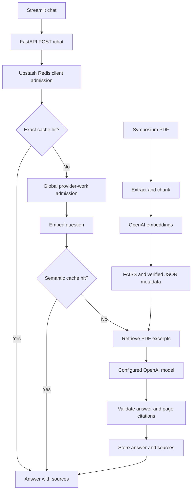

# Symposium RAG Bot

FastAPI and Streamlit chatbot that answers from `data/symposium.pdf`, with OpenAI embeddings, a local FAISS index, semantic answer caching, and shared Upstash Redis rate limits.

**Live demo: [symposium-rag-bot.vercel.app](https://symposium-rag-bot.vercel.app)**

The hosted demo uses a browser-native chat interface, the existing FastAPI retrieval pipeline and shared Upstash Redis caching. It answers from the fictional, contact-free sample guide. The original local PDF is not deployed. Streamlit remains available for local use.

## Features

[](https://github.com/harshgavandit/RAG-Semantic-Cache-Symposium-Bot/actions/workflows/tests.yml)

- PDF extraction, overlapping chunks, vector retrieval and document-grounded generation.
- Exact and semantic answer caching with source pages preserved on cache hits.
- Shared Redis admission with atomic Lua operations, retry headers and fail-closed handling.
- Verified FAISS vectors and JSON metadata without pickle deserialization.
- Clear timeout, rate-limit, provider and connection errors in the API and chat UI.
- 42 regression tests, repeatable live-service checks and recorded browser evidence.


## Architecture



SQLite is the fallback when optional Valkey search is unavailable. Upstash Redis handles admission in either cache mode.

## Quick start

Prerequisites: **Python 3.12**, an OpenAI API key and an Upstash Redis REST URL/token. Python 3.12 is the tested version. This is a local learning/demo app.

```bash
git clone https://github.com/harshgavandit/RAG-Semantic-Cache-Symposium-Bot.git
cd RAG-Semantic-Cache-Symposium-Bot
```

### Windows / PowerShell

Create an environment, install dependencies and copy the configuration template:

```powershell
py -3.12 -m venv .venv
.\.venv\Scripts\python.exe -m pip install -r requirements-dev.txt
Copy-Item .env.example .env
```

Edit `.env` locally and fill `OPENAI_API_KEY`, `UPSTASH_REDIS_REST_URL` and `UPSTASH_REDIS_REST_TOKEN`. Keep the model and limit defaults or adjust them as needed. The real `.env` is ignored by Git and never published. OpenAI and Upstash usage may incur charges according to your accounts.

Create the fictional, contact-free demo PDF, then build its local index. The generator refuses to overwrite an existing document:

```powershell
.\.venv\Scripts\python.exe scripts/create_sample_pdf.py
.\run.ps1 ingest
```

Start the backend and frontend in separate terminals:

```powershell
.\run.ps1 backend
```

```powershell
.\run.ps1 frontend
```

- Frontend: http://127.0.0.1:8502
- Backend health: http://127.0.0.1:8000/health
- Interactive API docs: http://127.0.0.1:8000/docs
- Cache statistics: http://127.0.0.1:8000/stats

The frontend launcher defaults to port 8502. To choose a different port, use `.\run.ps1 frontend -Port 8503`. If changing the backend port, also update `BACKEND_URL` in the local environment. The launcher binds both services to loopback and disables trusting proxy headers.

### macOS / Linux

```bash
python3.12 -m venv .venv
source .venv/bin/activate
python -m pip install -r requirements-dev.txt
cp .env.example .env
# Edit .env and fill the required credentials before starting the backend.
python scripts/create_sample_pdf.py
python -m phase1_ingestion.ingest
python -m uvicorn phase2_retrieval.backend:app --host 127.0.0.1 --port 8000 --no-proxy-headers
```

In a second terminal:

```bash
source .venv/bin/activate
python -m streamlit run phase2_retrieval/frontend.py --server.address 127.0.0.1 --server.port 8502 --server.headless true --browser.gatherUsageStats false
```

After changing the PDF or embedding model, run `python -m phase1_ingestion.ingest` to rebuild the index.

## Project structure

```text
.
├── .github/workflows/tests.yml  # Offline test workflow
├── data/                       # Local source document (PDFs ignored)
├── phase1_ingestion/ingest.py    # PDF ingestion and index generation
├── phase2_retrieval/
│   ├── backend.py               # FastAPI routes and chat orchestration
│   ├── frontend.py              # Streamlit chat UI
│   ├── cache.py                 # SQLite cache and optional BetterDB adapter
│   ├── rate_limit.py            # Atomic Upstash Redis admission
│   └── resources.py             # Verified index and model loading
├── vector_store/                # Generated local index (ignored)
├── scripts/create_sample_pdf.py # Fictional PDF generator with no contacts
├── scripts/verify_live.py        # Real provider and Redis checks
├── tests/                       # Offline regression suite
├── evidence/                    # Verification results and screenshot
├── config.py                    # Validated configuration
├── demo_embeddings.py           # Inspect chunks, vectors and retrieval
├── run.ps1                      # Windows launcher
├── .env.example                 # Credential-free configuration template
└── requirements-dev.txt         # Runtime dependencies plus pytest
```

## Configuration

| Variable | Default / purpose |
|---|---|
| `OPENAI_API_KEY` | Required; server-side OpenAI key |
| `LLM_MODEL` | `gpt-4o-mini`; `OPENAI_MODEL` is accepted as a fallback alias |
| `EMBEDDING_MODEL` | `text-embedding-3-small`; must match ingestion |
| `LLM_TIMEOUT_SECONDS` | `30`; provider timeout |
| `LLM_MAX_COMPLETION_TOKENS` | `1024`; bounds generated output |
| `UPSTASH_REDIS_REST_URL`, `UPSTASH_REDIS_REST_TOKEN` | Required when rate limiting is enabled |
| `RATE_LIMIT_ENABLED` | `true` |
| `RATE_LIMIT_REQUESTS` | `10`; client chat requests per window, including cache hits |
| `RATE_LIMIT_WINDOW_SECONDS` | `60` |
| `LLM_RATE_LIMIT_REQUESTS` | `60`; global requests that need provider work per window |
| `RATE_LIMIT_PREFIX` | `symposium:ratelimit`; use a unique prefix for independent deployments |
| `CACHE_BACKEND` | `auto`, `local`, `valkey`, or `redis`; Vercel requires `redis` |
| `CACHE_THRESHOLD` | `0.15` cosine distance; accepts similarity at least `0.85` |
| `CACHE_TTL_SECONDS` | `86400` |
| `CACHE_MAX_ENTRIES` | `256` per corpus/model namespace in the local cache |
| `VALKEY_HOST`, `VALKEY_PORT` | `localhost`, `6379` |
| `VALKEY_PASSWORD`, `VALKEY_TLS` | Optional authentication / TLS for Valkey |
| `BACKEND_URL` | `http://127.0.0.1:8000` |

Configuration loads from this folder's `.env`, regardless of the shell's working directory. Explicit process environment variables take precedence. Invalid limits, missing required credentials, and embedding/index mismatches stop startup with a configuration error. `APPROVAL_TURNAROUND_HOURS` is unrelated to this chatbot and has no runtime consumer.

## Caching and Redis

Upstash credentials power **rate limiting**. They do not replace BetterDB's Valkey search service. BetterDB requires Valkey with the search module; Upstash uses different search commands.

`CACHE_BACKEND=auto` tries Valkey at startup and uses a persistent SQLite semantic cache in `runtime/semantic-cache.sqlite3` when Valkey is unavailable. `/health` reports which backend is active. The verified configuration currently uses **local SQLite caching and real Upstash Redis rate limiting**.

`CACHE_BACKEND=valkey` requires Valkey and fails startup if it cannot initialize. To use it, start a Valkey service with the search module, such as the `valkey/valkey-bundle` image. Docker was unavailable during this verification, so the Valkey branch has not been live-tested.

With the local cache:

1. Every valid question passes Redis client admission before cache lookup or provider work.
2. An exact cached question returns its answer and sources without embedding or generation calls.
3. A new question passes the global provider-work budget and is embedded once.
4. A sufficiently similar cached question returns its stored answer and sources, skipping generation.
5. A miss searches the FAISS index for three excerpts and generates a cited answer.
6. Valid answers are stored with TTL and bounded entry count. Refusals and invalid/truncated answers are not cached.

Cache namespaces include the document/index fingerprint, embedding model, LLM model, threshold and prompt version. Local cache data persists across process restarts. Semantic similarity is a heuristic; tune the threshold against representative questions before broader use. Similarity alone does not prove that two questions require the same answer.

Redis admission uses one atomic Lua `EVAL`: accepted requests consume a slot; rejected requests do not extend the window. Quota rejection returns HTTP 429 and `Retry-After`. Redis failures return HTTP 503 and block provider work. No local rate-limit fallback bypasses Redis. The global limit counts requests requiring provider work, rather than every raw HTTP call to OpenAI. Ingestion is an offline administrative operation and does not use the chat admission buckets.

The Streamlit server sends requests from its own address, so browser users of this local UI share one client bucket. This is a local demo configuration; a public deployment needs authenticated user identities and deliberately configured trusted-proxy handling.

## Index and response contracts

The original local verification used a 5-page PDF and 9 chunks with 1,536-dimensional embeddings. Source PDFs and generated indexes stay local and are excluded from the public repository. The included generator creates a smaller fictional sample for a fresh clone; its chunk count differs from the recorded local evidence. Ingestion writes `index.faiss`, `documents.json` and `manifest.json`, and startup verifies their hashes and embedding model. The unused legacy `index.pkl` is never loaded.

`POST /chat` accepts `{"question":"What is the symposium date?"}` and preserves these response fields:

```json
{
  "answer": "The symposium date is March 15, 2026 [Page 1].",
  "sources": ["Page 1", "Page 2", "Page 5"],
  "cache_hit": false,
  "similarity": null
}
```

Page numbers are one-based. `sources` lists retrieved source pages; bracketed citations identify the pages used in the answer. Cache hits preserve the source list. Unsupported questions return an explicit document-only refusal with no sources. Citation validation rejects missing or unknown page labels; it does not establish factual entailment by itself.

The frontend displays HTTP failures, quota retry time, timeouts and connection failures without crashing. Backend responses avoid exposing provider exceptions or credentials. Local `/stats` reports `cost_saved_usd: null` because no pricing-based estimate is configured.

## Verification

```powershell
.\run.ps1 test
.\.venv\Scripts\python.exe -m pip check
.\run.ps1 verify
```

The live command requires a running backend and uses real OpenAI/Redis services. It makes a few chat requests, intentionally exhausts the local test client's quota, and exercises unique Redis test keys that expire automatically. Wait for the normal client window to expire before repeating it; do not reset shared Redis data.

Evidence is in `evidence/live-verification.json`, `evidence/frontend-cache-hit.jpg` and `evidence/verification-report.md`. Live checks cover grounded generation, exact/semantic hits, refusal, invalid input, HTTP 429, concurrent atomic admission, shared denial, expiry and invalid-token failure. Regression tests also cover configuration, cache persistence/TTL/bounds, frontend failures, malformed generation, and verified JSON index loading.

`DOCUMENTATION.md` and `DOCUMENTATION.pdf` contain the original learning guide. The README and current source describe the updated configuration and runtime behavior.

For any platform, the offline test command is `python -m pytest -q`. GitHub Actions runs the suite, dependency consistency and syntax checks on Python 3.12. CI does not require API keys or make live provider requests.

### Recorded local results

| Check | Result |
|---|---|
| Regression suite | 34 passed, including public sample generation |
| Main live verification | 11 checks passed |
| Atomic Redis concurrency | 3 of 10 admitted at limit 3 |
| Generated answer | March 15, 2026, cited to Page 1 |
| Exact cache latency | 0.011 seconds |
| Paraphrase cache latency | 0.351 seconds; similarity 0.8752 |

Latencies are single-run local observations, not production guarantees. The optional Valkey branch has not been live-verified. The local cache does not fabricate pricing-based dollar savings.

## Vercel deployment

The live version runs on Vercel's Python 3.12 FastAPI runtime. Static browser assets are served by Vercel's CDN. The cloud build generates the fictional sample PDF and verified index under `deploy_data/`, which is isolated from local PDFs and indexes. Hosted cache entries, counters and limits are shared through Upstash REST; the app does not write SQLite data on Vercel.

`pyproject.toml` lists only the hosted runtime dependencies. `.vercelignore` excludes private documents, generated local indexes, `.env` files, virtual environments, logs and development artifacts. Production credentials are Vercel server-side secrets, never frontend configuration.

To deploy to your own Vercel account, link a project with `npx vercel link`, add `OPENAI_API_KEY`, `UPSTASH_REDIS_REST_URL` and `UPSTASH_REDIS_REST_TOKEN` as production environment variables, then run `npx vercel deploy --prod`. Set optional model and rate-limit variables as needed. Do not paste credentials into source files or CLI arguments.

See [deployment details](docs/vercel-deployment.md), [hosted verification](evidence/vercel-verification-report.md) and [public API evidence](evidence/vercel-live-verification.json). Hosted checks include real generation, exact and paraphrase hits, refusal, HTTP 429, Redis concurrency and visible browser citations. The live demo is a bounded learning project; the existing limitations concerning semantic false hits, citation entailment and public-use cost still apply.
